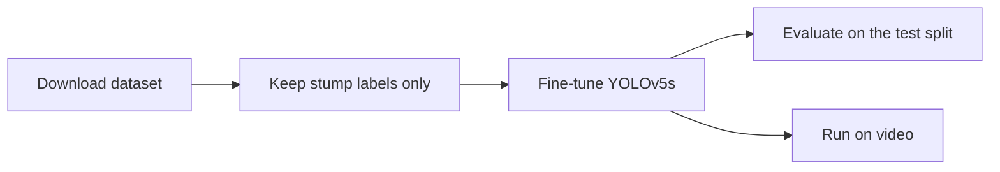

# YOLOv5 Cricket Stump Detector

Detects cricket stumps in images and video using a fine-tuned YOLOv5s model.

## Results

**Status: not trained on the real dataset yet.** This section will show the test metrics from `results/metrics.json` after training.

## How it works



1. **Data:** the source dataset labels ball, bat and stumps. `prepare_dataset.py` keeps only the stump boxes and renumbers them as a single class. Frames with no stumps stay in as background examples.
2. **Training:** starts from pretrained YOLOv5s weights (`yolov5su.pt` from Ultralytics) using the settings in `configs/train.yaml`.
3. **Augmentation:** small rotations, horizontal flips, brightness and saturation changes, scaling and mosaic. Vertical flips are off, because stumps are never upside down.
4. **Evaluation and inference:** `evaluate.py` saves metrics to `results/metrics.json`. `detect_video.py` writes an annotated video and prints the real FPS.

## Project structure

```text
yolov5-cricket-stump-detector/
├── configs/train.yaml      # Model and augmentation settings
├── scripts/
│   ├── download_dataset.py # Downloads from Roboflow Universe
│   ├── prepare_dataset.py  # Keeps the stump class only
│   ├── train.py            # Fine-tunes the model
│   ├── evaluate.py         # Saves test metrics
│   ├── detect_video.py     # Runs on a video or webcam
│   └── make_smoke_dataset.py # Tiny fake dataset to test the pipeline
├── src/stump_detector/     # Label filtering and dataset preparation
├── tests/                  # Tests for dataset preparation
└── results/                # Saved metrics
```

## Setup

Tested on Python 3.14 with an RTX 4050. A GPU is recommended. Install the PyTorch build for your system from [pytorch.org](https://pytorch.org/get-started/locally/) first.

```bash
python -m venv .venv
.venv\Scripts\activate
pip install -r requirements.txt
copy .env.example .env
```

Then add your free Roboflow API key to `.env`.

## Usage

```bash
python scripts/download_dataset.py
python scripts/prepare_dataset.py
python scripts/train.py
python scripts/evaluate.py
python scripts/detect_video.py --source path/to/match.mp4
```

To check that the pipeline runs without the real data, use the fake dataset. Numbers from this run mean nothing about real stumps:

```bash
python scripts/make_smoke_dataset.py
python scripts/train.py --data data/smoke/data.yaml --epochs 1 --name smoke
```

## Tests

```bash
pytest
```

## Dataset

[bat ball stumps detection](https://universe.roboflow.com/lbwdrs/bat-ball-stumps-detection-uoehl) by LBWDRS on Roboflow Universe, CC BY 4.0. The dataset is not stored in this repo.

## Limitations

- Results depend on how well this dataset matches your footage, such as camera angle and lighting.
- FPS depends on your hardware, so measure it on your own machine with `detect_video.py`.
